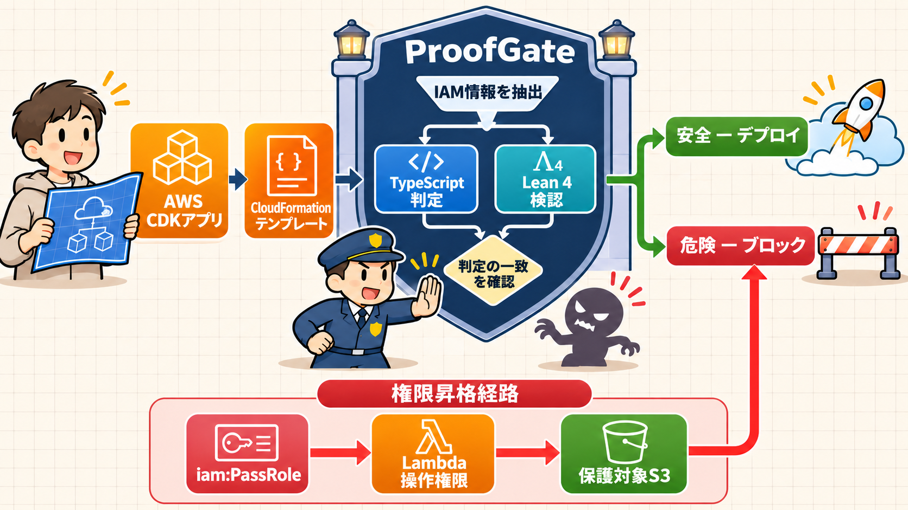

# ProofGate

**English:** start with [Getting started with ProofGate](docs/GETTING_STARTED.en.md): one CDK stack that synthesizes, is rejected by ProofGate, is fixed, and passes, in about 10 minutes and without an AWS account.

## 概要

ProofGateは、AWS CDKが生成したCloudFormationを解析し、危険なIAM権限昇格経路が存在しないことをデプロイ前にLeanで機械検証するCDK Validation Pluginです。

現在の実装では、対応範囲内のIAM構成において、`iam:PassRole`と起動サービス（Lambda、ECS、EC2、CodeBuild、Step Functionsなど、ロールを渡して動かせるサービス）の操作権限を組み合わせ、渡したロールを経由して保護対象S3バケットへ到達する経路を検査します。さらに、`iam:PassRole`がなくても、すでにそのロールで動いているLambda関数、CodeBuildプロジェクト、Step Functionsのステートマシンを変更できる経路も検査します。ロールが自分でIAMを書き換えられる構成（自分のロールへのポリシーの付与など）は、別のルール`PG-IAM-005`で検査します。安全条件を満たさないスタックは、通常のCDKワークフロー内でデプロイ前に拒否されます。



> [!IMPORTANT]
> ProofGateが現在検証するのは、すべてのIAMロールが一般的な意味で最小権限であることではありません。対応するCloudFormation・IAM構文と設定された保護対象バケットを前提として、上記の特定の権限昇格経路が存在しないことを検証します。

## 解決しようとしている課題

IAMの危険性は、単一のポリシーや単一のロールだけを見ても分からない場合があります。個別には正当そうに見える権限でも、次の権限が異なるロールをまたいで組み合わさると、保護データへ到達する権限昇格経路になります。

1. IAMプリンシパルが対象ロールに対する`iam:PassRole`権限を持っている
2. 同じプリンシパルが、ロールを渡してサービスを動かす操作（起動アクション）を持っている。たとえば、Lambda関数の作成や設定の更新、ECSのタスクの実行、EC2のインスタンスの起動、CodeBuildのプロジェクトの作成です（Lambdaの設定の更新では実行ロールとレイヤーを変えられるため、コードの更新権限は要りません。1.1.1までは、ロール設定とコードの両方の更新を要求していました。1.1.2まではLambdaだけを検査していました）
3. 対象ロールが、そのサービスを信頼している
4. 対象ロールが設定で指定された保護対象S3バケットへアクセスできる

`iam:PassRole`が要らない形もあります。主体が、保護対象バケットを読めるロールで動いている既存のLambda関数のコードを書き換えられる（`lambda:UpdateFunctionCode`）、既存のCodeBuildプロジェクトのビルドを`buildspecOverride`付きで始められる（`codebuild:StartBuild`）、既存のステートマシンの定義を更新できる（`states:UpdateStateMachine`）場合です。新しいコードや定義は、そのロールの権限で動きます。
ロールが自分でIAMを書き換えられる場合も、同じ結果になります。自分のロールにポリシーを付けられる（`iam:PutRolePolicy`、`iam:AttachRolePolicy`）、バケットに届く別のロールの信頼ポリシーを書き換えられる（`iam:UpdateAssumeRolePolicy`）、ロールを作ってポリシーを付けられる（`iam:CreateRole`と付与）場合です。ProofGateは、これを`PG-IAM-005`として報告します。

通常の`cdk synth`は有効なCloudFormationを生成できますが、その構成がアプリケーション固有の安全条件を満たしているかまでは判断しません。人手によるレビューだけで、複数のIAM Statement、信頼ポリシー、Lambda操作権限、S3アクセスの関係を継続的に追跡することも困難です。

ProofGateは、このような「権限の組み合わせによって初めて成立する攻撃経路」を、デプロイ前の再現可能な検証対象にします。

## アプローチ方法

ProofGateは、CDKの合成処理に次の検証パイプラインを追加します。

1. **CloudFormationを取得する**: CDK Validation Pluginとして、`cdk synth`が生成したテンプレートを受け取ります。
2. **IAM情報を抽出する**: ロール、インラインポリシー、信頼関係、`Action`、`Resource`を、CDKに依存しない中間モデルへ変換します。
3. **候補経路を評価する**: TypeScript評価器が、PassRole、起動アクション、そのサービスへの信頼、保護対象S3アクセスの組み合わせを、サービスごとに列挙します。起動アクションは、AWS Service Referenceから生成した表（879件）です。あわせて、ロールで動く既存のリソースを変更できる経路（PassRoleなし）と、ロールがIAMを書き換えられる経路も列挙します。
4. **Leanで安全条件を検査する**: 3種類の候補経路の一覧（`EscalationPath`、`ImplicitPath`、`PolicyWritePath`）からLeanモジュールを生成し、完全な権限昇格経路が存在しないことを固定されたLeanツールチェーンで判定します（[証明](docs/PROOFS.md)）。
5. **CDKへ結果を返す**: 危険な経路は`PG-IAM-004`（ロールがIAMを書き換える経路は`PG-IAM-005`）として拒否し、未対応構文やTypeScriptとLeanの判定不一致は`PG-IAM-003`としてFail Closedで拒否します。

Leanが検査する事実は、CloudFormationからTypeScriptで抽出・構成された候補経路です。そのため、ProofGateはLeanがIAMやCloudFormationの意味論全体を独立して証明すると主張しません。抽出器とTypeScript評価器はテストおよび独立Oracleで検証し、Leanは生成された安全条件を機械的に検査する、という責務分担を採用しています。

このリポジトリはKiroに依存しません。TypeScript、Lean 4、pnpm、およびAWS CDKの安定版`IPolicyValidationPlugin` APIを使用します。

## 必要な環境

- Node.js 26以降（`.nvmrc`では26.13.1に固定）
- pnpm 11
- `elan`で導入したLean 4 / Lake（正確なバージョンは`packages/cdk-plugin/lean/lean-toolchain`で固定）

## デモの実行

```bash
pnpm install
pnpm build
pnpm lean:build

# 通常のsynthは両方とも成功する
pnpm --filter @proofgate-cdk/safe-app synth
pnpm --filter @proofgate-cdk/vulnerable-app synth

# ProofGateはsafe-appを許可する
pnpm --filter @proofgate-cdk/safe-app synth:proofgate

# ProofGateはvulnerable-appをPG-IAM-004、終了コード1で拒否する
pnpm --filter @proofgate-cdk/vulnerable-app synth:proofgate
```

自動テスト一式は`pnpm test`で実行できます。生成テスト（独立したオラクルとLeanによる照合、CloudFormation断片の読み戻し）の実行方法と環境変数は、[`tests/pbt/README.md`](tests/pbt/README.md)（英語）を参照してください。

コード品質チェックは次のコマンドで実行できます。

```bash
pnpm quality
```

このコマンドはBiomeによるフォーマット・Lint・Assist検査、Knipによる未使用ファイル・依存関係・export検査、jscpdによる重複コード検査を順番に実行します。自動修正可能なBiomeの指摘は`pnpm biome:fix`で修正できます。

## 検証に使う例とデータ

- `examples/safe-app`、`examples/vulnerable-app`: デモの2つのアプリ（上記）。
- `examples/real-stacks`: 実際のCDKコードに近い84の構成（RS-01〜RS-84）。`pnpm real-stacks`で評価用の14構成を期待表と比べます。ほかの構成の組は`--holdout`、`--probe`、`--launch`、`--incident`、`--implicit`、`--policy-write`、`--trial2`で選びます。結果は[実スタックでの試験結果](docs/REAL_STACKS.md)にあります。
- `examples/trial-app`: 利用者と同じ形で試す24の変種のアプリ。`pnpm --filter @proofgate-cdk/trial-app variants`で、すべての変種を期待表と比べます。npmの公開版との比較の手順は[`examples/trial-app/README.md`](examples/trial-app/README.md)にあります。
- `tests/pathfinding-benchmark.test.ts`: Datadogの[pathfinding.cloud](https://pathfinding.cloud/)（Apache-2.0）のAWSの91経路を、2つのロールのモデルにして測ります。今の`main`は91経路中60件を指摘します（`PG-IAM-004`が52件、`PG-IAM-005`が8件）。攻撃の前提だけを再現したもので、実際に攻撃が成立するかは見ていません。
- `tests/pbt/`: 独立したオラクル、TypeScript評価器、Leanの3者を照合する生成テスト（`pnpm test`に含まれます）。

いずれもAWSの認証情報とデプロイを使いません（合成だけです）。

English: examples and data used for verification. `examples/real-stacks` has 84 realistic CDK Patterns (`pnpm real-stacks`, other sets by flag; results in `docs/REAL_STACKS.md`). `examples/trial-app` has 24 variants that try ProofGate the way a user does (`pnpm --filter @proofgate-cdk/trial-app variants`). The pathfinding.cloud benchmark (91 AWS paths as two-role models) reports 60 paths on `main` (52 `PG-IAM-004`, 8 `PG-IAM-005`); it reproduces only the preconditions of each attack. `tests/pbt/` compares an independent oracle, the evaluator, and Lean. No AWS credentials or deployment are used.

## 公開版と開発版

npmの最新版は1.2.0（2026-11-23公開、4パッケージとも同じ版）で、このREADMEが説明する`main`の内容と同じです。1.1.2からの変更は[CHANGELOG](CHANGELOG.md)の「1.2.0」にあります。主な追加は、Lambda以外の起動サービス（879の起動アクション）、`iam:PassRole`の要らない経路、ロール自身がIAMを書き換える経路（`PG-IAM-005`）と設定項目`allowedPolicyWriters`です。

English: npm has 1.2.0 (published 2026-11-23, the same version for all four packages), which is what this README describes. The changes from 1.1.2 are in the "1.2.0" section of the CHANGELOG.

## 公開パッケージ

次の4パッケージをnpmで公開しています。

- `@proofgate-cdk/cdk-plugin`: CDK利用者向けのValidation Plugin。固定済みLeanプロジェクトを同梱
- `@proofgate-cdk/core`: TypeScript参照評価器とLeanモジュール生成器
- `@proofgate-cdk/extractor`: CloudFormation IAM Extractor
- `@proofgate-cdk/model`: CDK非依存の中間モデル

公開前に、各tarballのエントリーポイント、型定義、README、ライセンス、Leanソース、workspace依存のsemver変換を検査できます。

```bash
pnpm pack:check
```

公開は、`pnpm publish -r --access public`で4パッケージを同じ版で出します（`workspace:`の依存をsemverへ変換するため、`npm publish`は使いません）。

## CDKへの導入

```bash
pnpm add @proofgate-cdk/cdk-plugin
```

Node.js 26以降と、`elan`で導入したLean 4 / Lakeが必要です。

```ts
import { App, Validations } from "aws-cdk-lib";
import { ProofGateValidator } from "@proofgate-cdk/cdk-plugin";

const app = new App();
Validations.of(app).addPlugins(
  new ProofGateValidator({
    protectedBucketArns: ["arn:aws:s3:::production-data"],
  }),
);
```

プラグインは`IPolicyValidationContext.templatePaths`を読み取り、意図的に範囲を限定したIAMモデルを抽出します。次に、具体的なLeanモジュールを生成し、完全な権限昇格経路が存在しないことをLeanカーネルに検査させます。未対応のポリシー構文は`PG-IAM-003`として報告し、Fail Closedで拒否します。

## 導入ガイド

試用アプリ（[`examples/trial-app`](examples/trial-app/README.md)。npmの1.1.2と、このリポジトリの現在のコード）で確かめた手順と注意点です。項目8と9（PassRoleの要らない経路、`PG-IAM-005`）は、まだnpmに公開していない機能です。

1. **すべてのスタックが検査されます。** プラグインは、アプリの中のすべてのスタックのテンプレートを読みます。保護対象バケットの設定は、すべてのスタックで共通です。
2. **保護対象バケットには、固定の名前とリテラルのARNを使います。** `protectedBucketArns`には`arn:aws:s3:::my-data`のような文字列を書きます。`bucket.bucketArn`はトークンなので使えません。バケットに`bucketName`を付けてください。名前のないバケットは、リテラルの保護対象バケットとは一致しないものとして読みます（`docs/ASSUMPTIONS.md`）。
3. **普段の`cdk synth`と`cdk deploy`に影響させないために、環境変数で登録します。**

   ```ts
   if (process.env.PROOFGATE === "1") {
     Validations.of(app).addPlugins(
       new ProofGateValidator({ protectedBucketArns: ["arn:aws:s3:::my-data"] }),
     );
   }
   ```

   `PROOFGATE=1 npx cdk synth`で検査します。違反があると終了コード1です。
4. **Leanが必要です。** `elan`でLean 4とLakeを入れてください。初回の検査で、同梱のLeanプロジェクトをビルドします。
5. **よくある`PG-IAM-003`と直し方**
   - 表にない管理ポリシー（`AdministratorAccess`など）: ProofGateが読む管理ポリシーは、`AWSLambdaBasicExecutionRole`、`AWSLambdaVPCAccessExecutionRole`、`AmazonAPIGatewayPushToCloudWatchLogs`、`AmazonSSMManagedInstanceCore`、`AWSGlueServiceRole`、`AWSBackupServiceRolePolicyForBackup`、`AWSBackupServiceRolePolicyForRestores`の7件だけです。ほかの管理ポリシーは、インラインポリシーに書き直すか、そのロールを別のアプリに分けてください。1.1.2では、API Gatewayの`RestApi`が作るCloudWatchロールの管理ポリシーを読めなかったため、`cloudWatchRole: false`が必要でした。今のコードでは不要です。
   - `Resource`のパラメータ（`CfnParameter`）や`Fn::ImportValue`（スタックをまたぐ参照）: 値が分からないため読みません。リテラルか、同じスタックのリソースへの参照にしてください。
   - `Resource`のIAMポリシー変数（`${aws:username}`など）: 変数を使わない書き方にしてください。
   - 渡せて保護対象バケットに届くロールが、ProofGateの表にないサービスを信頼している: そのサービスがロールでコードを動かすかどうかを判断できないため拒否します。ロールを渡せないようにするか、バケットへのアクセスを外してください。
6. **IAMリソースのないテンプレートは受理します。** 検査するプリンシパルがないからで、「安全と証明した」という意味ではありません。ネストしたスタック、`Transform`、`AWS::Serverless::`のリソースを含むテンプレートは拒否します。
7. **モデルの外にあるもの**: SCP、Permissions Boundary、リソースポリシー、Explicit Deny、条件（`iam:PassedToService`など）、スタックやアカウントをまたぐ参照、Lambda、CodeBuild、Step Functions以外のサービスでの`iam:PassRole`の要らない経路、IAMユーザーとグループ、ロールの連鎖、デプロイ後のドリフトです。詳しくは[前提・信頼境界](docs/ASSUMPTIONS.md)を見てください。
8. **PassRoleの要らない経路の直し方。** 保護対象バケットを読めるロールで動いているLambda関数、CodeBuildプロジェクト、ステートマシンを、主体が変更できると`PG-IAM-004`になります（文面は「`X` can change `Y` (`<action>`), which runs as `Z`」）。変更の権限を外すか、`Resource`をバケットに届かないリソースのARNに絞るか、ロールからバケットへのアクセスを外してください。チームが承知しているロールなら、`allowedPassRoleTargets`にそのロールの論理IDを入れると、この経路も許可します。関数のロールが`Fn::ImportValue`やパラメータで、テンプレートから特定できないときは、その関数を変更できる主体がいる場合に`PG-IAM-003`になります。関数のロールは、同じテンプレートのロールを`Fn::GetAtt`で参照してください。CDKの`Function`、`Project`、`StateMachine`を普通に使えば、そうなります。
9. **IAMを書き換えるロールの直し方（`PG-IAM-005`）。** 文面は「`X` can write a policy to its own role (`iam:AttachRolePolicy`), so it can give itself access to ...」のようになります。`iam:PutRolePolicy`、`iam:AttachRolePolicy`、`iam:UpdateAssumeRolePolicy`、`iam:CreateRole`の権限を外すか、`Resource`をバケットに届かないロールのARNに絞ってください。`Action: "*"`の管理者ロールも指摘されます。管理者ロールは、検査するアプリとは別に置くことをおすすめします。ID管理のパイプラインのように、意図してIAMを書き換えるロールなら、その論理IDを`allowedPolicyWriters`に入れます。

   ```ts
   new ProofGateValidator({
     protectedBucketArns: ["arn:aws:s3:::my-data"],
     allowedPolicyWriters: [stack.getLogicalId(pipelineRole.node.defaultChild as CfnRole)],
   });
   ```

   `allowedPassRoleTargets`とは別の項目です。`iam:PermissionsBoundary`などの`Condition`で付与を制限したStatementは、`PG-IAM-003`になります。
10. **`Validations.of(app).acknowledge`で`ProofGate::PG-IAM-004`や`ProofGate::PG-IAM-005`を認めると、そのsynthは成功します。** 本当に例外にする場合だけ使ってください。

English: an adoption guide checked with the trial app. A path without `iam:PassRole` is reported too: a principal that can change an existing Lambda function, CodeBuild project, or state machine that runs as a role reaching the protected bucket; fix it by removing the permission, scoping the `Resource` to resources whose role cannot reach the bucket, or listing the role in `allowedPassRoleTargets`. A role that can change IAM itself (`iam:PutRolePolicy` or `iam:AttachRolePolicy` on its own role, `iam:UpdateAssumeRolePolicy` on a role that reaches the bucket, `iam:CreateRole` with a grant) is reported as `PG-IAM-005`, administrator roles included; remove or scope the permission, keep administrator roles out of the checked app, or list a role that writes IAM on purpose in `allowedPolicyWriters` (separate from `allowedPassRoleTargets`). Every stack is checked; the protected bucket needs a fixed name and a literal ARN; register the plugin only when `PROOFGATE=1`; install Lean with `elan`. Common `PG-IAM-003` causes: a managed policy outside the seven that are read, a parameter or `Fn::ImportValue` in a `Resource`, an IAM policy variable, and a passable, bucket-reaching role that trusts a service ProofGate does not know. A template without IAM resources is accepted because there is no principal to check, not because it was proved safe. SCPs, permissions boundaries, resource policies, explicit deny, conditions, cross-stack references, paths without `iam:PassRole` through services other than Lambda, CodeBuild, and Step Functions, IAM users and groups, role chains, and drift are outside the model. An acknowledgement of `ProofGate::PG-IAM-004` or `ProofGate::PG-IAM-005` makes the synth succeed.

## 現在の対応範囲

ProofGateは完全なIAM評価器ではありません。テンプレート内の`AWS::IAM::Role`、インラインポリシー、ロールに付けた`AWS::IAM::Policy`、表にある7件の管理ポリシー、`AWS::IAM::InstanceProfile`を読みます。`Resource`は、リテラル、`Fn::Join`、`Fn::Sub`、疑似パラメータ、同じテンプレートのバケット、ロール、Lambda関数、CodeBuildプロジェクト、ステートマシンへの`Ref`と`Fn::GetAtt`を読みます。それ以外は`PG-IAM-003`で拒否します。デプロイ制御として使用する前に、[対応するIAM構文](docs/SUPPORTED_IAM.md)と[前提・信頼境界](docs/ASSUMPTIONS.md)を確認してください。

以下は、版ごとの記録です。

1.1.0では、これに加えて、Resourceの`Fn::Join`、疑似パラメータ、同じテンプレート内のバケットとロールへの`Ref`・`Fn::GetAtt`、管理ポリシー`AWSLambdaBasicExecutionRole`、信頼ポリシーの`Allow`に付いた`Condition`を読みます。実際のCDKコードに近い14の構成で試したところ、1.0.1では8件が未対応（`PG-IAM-003`）でした。主な原因は、管理ポリシー、リテラルではない`Resource`、信頼ポリシーの`Condition`です。1.1.0では、未対応は14件中1件（IAMポリシー変数）、実装の後に1回だけ試した別の8構成では1件（表にない管理ポリシー）です。これらは標本であり、ほかのプロジェクトで同じ結果になるとは限りません。結果の表は[実スタックでの試験結果](docs/REAL_STACKS.md)にあります。

ロールで動くリソース（Lambda関数、CodeBuildプロジェクト、ステートマシン）を主体が変更できる経路は、`iam:PassRole`がなくても検査します。ロールが自分でIAMを書き換えられる構成は`PG-IAM-005`です（`docs/SUPPORTED_IAM.md`）。IAMリソースを含まないテンプレート（ロールのないスタック）は、検査するプリンシパルがないため受理します。「証明済み」という意味ではありません（`docs/SUPPORTED_IAM.md`）。S3アクセスは、保護対象バケット内の一部（プレフィックスや単一オブジェクト）へのアクセスも検出します。オブジェクトの過去の版の読み取りと削除、ACLの変更、複製といったAction（44個）に加えて、バケットポリシーやACLを変えられるAction、複製とライフサイクルの設定も数えます（`docs/SUPPORTED_IAM.md`）。`Resource`にIAMポリシー変数（`${aws:username}`など）を含むStatementは評価せず、`PG-IAM-003`で拒否します。
