<!-- _class: top -->
<!-- _paginate: false -->

# ProofGate

synthで止める、権限昇格の道

---

<!-- _class: image-full -->
<!-- _header: 課題 -->

# 1つずつ見ればふつうの権限

---

<!-- _class: image-full -->
<!-- _header: 課題 -->

# 既存ツールの指摘はポリシー単位だった

---

<!-- _class: image-full -->
<!-- _header: 課題 -->

# 4つそろうと道ができる

---

<!-- _class: image-full -->
<!-- _header: アプローチ -->

# 2つの実装が食い違えば止める

TypeScript が出した4つの真偽値を、Lean が検査します。

---

<!-- _class: image-full -->
<!-- _header: アプローチ -->

# 分からないものは通さない

---

<!-- _class: image-full -->
<!-- _header: 検証 -->

# 公開されている91の昇格経路で試した

---

<!-- _class: image-full -->
<!-- _header: まとめ -->

# 経路ごと、デプロイ前に止める

---

<!-- _class: crosshead -->

# 止まったら、どう直す？

---

<!-- _class: image-full -->
<!-- _header: 補足 -->

# テンプレートから証明まで

---

<!-- _class: image-full -->
<!-- _header: 補足 -->

# Leanが見るのは4つの○×

TypeScript が計算した4つの真偽値を、Lean が検査します。

---

<!-- _class: appendix -->
<!-- _header: 補足 -->

# ルールID一覧

| ルールID | 見つけるもの | 例 |
| --- | --- | --- |
| PG-IAM-003 | 読めない構文、判定の食い違い | 読めないものは止める |
| PG-IAM-004 | 保護したいS3に届く権限昇格の経路 | 渡す → 起動 → S3 |
| PG-IAM-005 | ロールが自分でIAMを書き換えられる構成 | 自分に権限を付与 |
